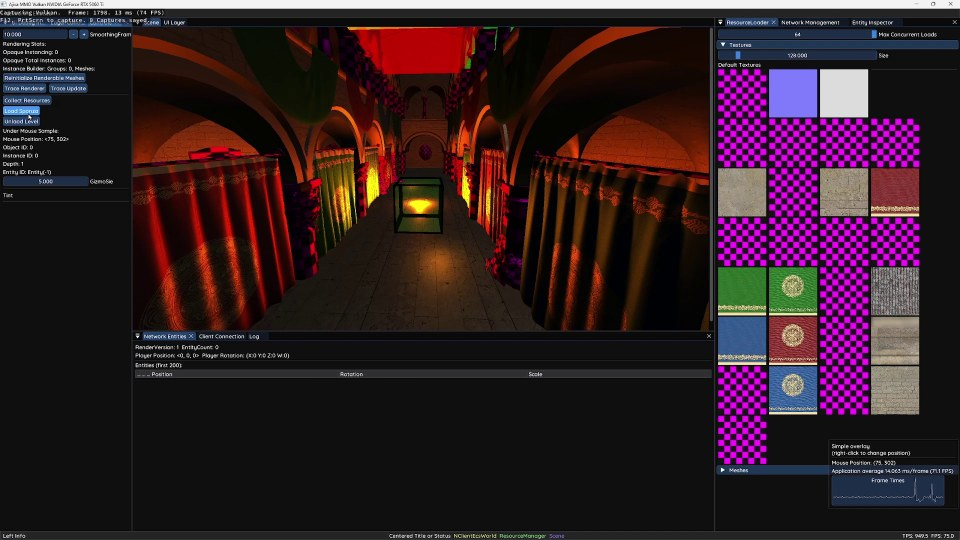
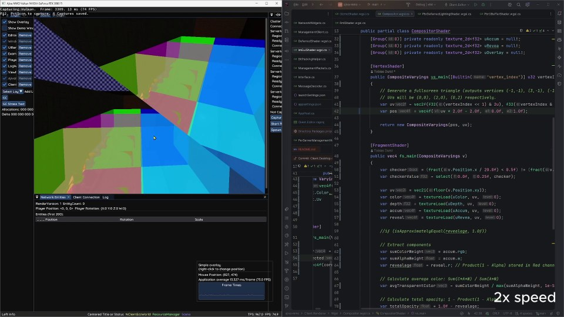
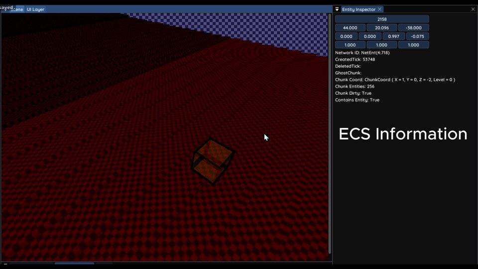
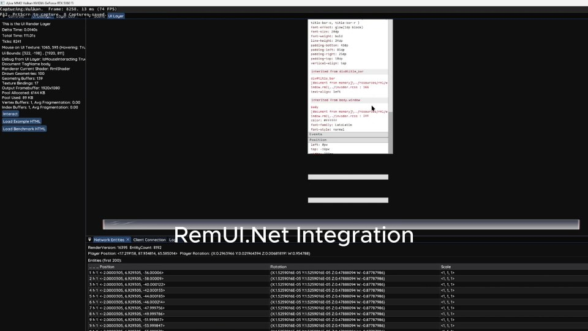
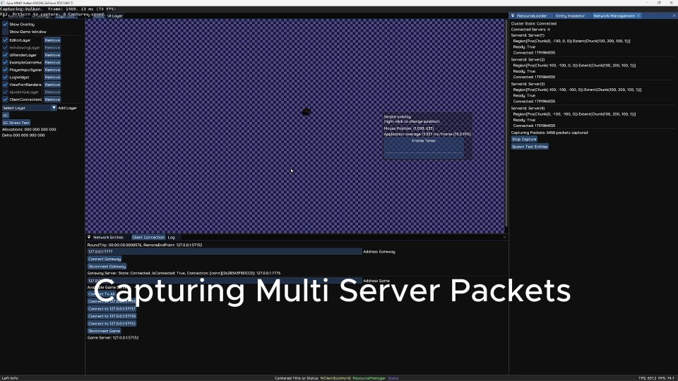
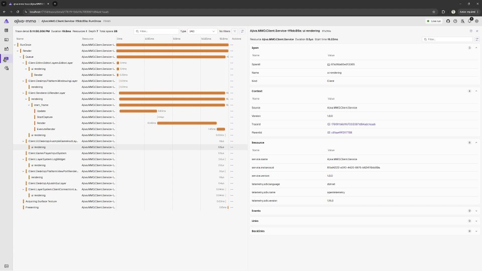

# Ajiva MMO

A personal C# game-engine experiment exploring WebGPU, distributed applications, and MMO technology.

After building a Vulkan engine, I wanted to try WebGPU and explore distributed worlds and ideas such as server meshing. Along the way, I got interested in how ImGui's detachable viewports work, how to write its renderer backend, and how much of this technology I could combine. That led to experiments with RmlUi, QUIC, Aspire, and shaders authored in C#.

This project is where I learn how those pieces work and build them into one application. It currently combines a native WebGPU renderer, an ImGui editor, a custom entity-component system, and a QUIC-based client/server architecture.

Rendering and editor features coexist with experimental networking and world distribution. Replication still has known correctness issues, and server meshing remains a future goal. There are no published player-count or performance benchmarks.

Six short clips below show loading, shader reload, ECS editing, UI events, network capture/replay, and render traces. Click a preview to open the video file on GitHub. If GitHub cannot preview it, use **View raw** to open or download the MP4.

[Development and setup](#development) · [Repository map](#repository-map) · [Planned work](#planned-work)

## Rendering

Native WebGPU rendering with deferred PBR, instancing, transparency, and GPU picking.

[Concurrent loading and mesh mutation · 28 seconds](docs/showcases/concurrent-loading.mp4): level loading, mesh copying, and in-place mutation.

[](docs/showcases/concurrent-loading.mp4)

<details>
<summary>Render passes, scene tools, and current limits</summary>

- Silk.NET and wgpu handle native WebGPU access, with a separate renderer project and explicit GPU resource management.
- A geometry pass writes base color, normals, metallic/roughness/AO, emissive data, object IDs, and depth; a subsequent pass applies lighting.
- Renderable ECS entities are grouped by mesh ID and assembled into instance buffers. The active dynamic-entity path currently uses a default cube mesh and material; imported scene meshes have their own instance buffers.
- Weighted blended order-independent transparency uses separate accumulation and revealage targets, combined with the opaque scene in a compositor pass.
- A compute shader samples object ID, instance ID, and depth for editor selection and inspection.
- Scene tools include a free camera, selection highlights, and a gizmo overlay. Assimp and ImageSharp handle model and texture loading.

Start with [the renderer](Client.Renderer/Renderers/Instanced3dDeferredRenderer.cs), [instance grouping](Client.Renderer/Instancing/UnifiedRenderableInstanceCollectionBuilder.cs), and [the render pipelines](Client.Renderer/Pipelines).

</details>

## Shaders in C#

Write shaders in C#, generate WGSL and binding helpers, and reload shaders while the application runs.

[Live shader reload · 35 seconds](docs/showcases/shader-reload.mp4): edit a C# shader and see the render pipeline rebuild while the application runs.

[](docs/showcases/shader-reload.mp4)

<details>
<summary>Shader generation and live reloading</summary>

A custom Roslyn incremental source generator translates an annotated subset of C# into WGSL. Shader classes describe vertex, fragment, and compute entry points, bindings, and input layouts. Generation also produces C# helpers for WebGPU layouts and bindings, keeping shader declarations and host-side setup close together.

The renderer's shaders are authored in this format, including the PBR geometry and lighting passes, transparency, ImGui, gizmos, and picking.

During development, a shader reload service watches `*.wgsl.cs` files, reruns generation, compiles the generated C# into an assembly, and replaces the active shader object. Render pipelines check shader versions and recreate themselves when needed. This supports editing shaders while the application is running.

The generator implements the shader-oriented C# constructs used by this project; it is not a general-purpose C# compiler for the GPU.

See [the generator](Generators/WgslGenerator), [shader examples](Client.Renderer/Wgsl), and [shader reloading](Client.Renderer/Wgsl/ShaderReloadManager.cs).

</details>

## Editor and desktop integration

An ImGui editor with detachable windows, scene inspection, resource tools, and cluster controls; RmlUi supplies document-based game UI.

[ECS picking and transform smoothing · 53 seconds](docs/showcases/ecs-picking-smoothing.mp4): select an entity, edit its position and scale, and compare the immediate gizmo update with the renderer's smoothed transform.

[](docs/showcases/ecs-picking-smoothing.mp4)

[RmlUi hit testing and events · 42 seconds](docs/showcases/rmlui-events.mp4): hit testing, event target resolution, dispatch, and bubbling in the game UI.

[](docs/showcases/rmlui-events.mp4)

<details>
<summary>Editor tools and windowing</summary>

The editor uses Dear ImGui with docking and detachable native windows. SDL3 and its ImGui backend provide platform windowing and input; this project supplies the WebGPU rendering integration, viewport renderer callbacks, and per-window surface management.

Editor tools include:

- Entity inspection with editable transforms and network/chunk state.
- Object selection from the rendered scene.
- Texture inspection, resource listings, and load controls.
- Instance counts, frame/update timing, logs, and tracing controls.
- Server connections, management actions, and region visualization.

A separate RmlUi integration supplies a WebGPU rendering backend for document-based game UI.

See [the editor widgets](Client.Editor/EditorLayers/Widgets), [ImGui integration](Client.Renderer/Renderers/ImGuiPlatform.cs), [surface management](Client.Desktop/SurfaceManager.cs), and [RmlUi rendering](Client.UI.Desktop/wgpu/RmlWebGpuRenderer.cs).

</details>

## Networking and world distribution

QUIC transport, generated packets, chunk replication, and server discovery are implemented. Replication still needs correctness work; Networking 2.0 is under development.

[Network capture and replay · 36 seconds](docs/showcases/network-capture-replay.mp4): capture and replay traffic from multiple servers, including loading/unloading behavior and visible replication bugs.

[](docs/showcases/network-capture-replay.mp4)

<details>
<summary>Current networking architecture and limitations</summary>

The existing networking layer uses .NET QUIC and MemoryPack. A packet source generator creates packet identifiers, serialization/send helpers, and typed dispatch interfaces from annotated packet declarations.

World replication is organized around spatial chunks:

- Chunk load and unload messages maintain client visibility.
- Membership deltas describe entities entering or leaving chunks.
- Position updates use chunk-relative 16-bit quantization per axis.
- Rotation and scale updates use dirty tracking and indexed component updates.
- Client rendering smooths received entity transforms.

Capture/replay tooling is also present for investigating network traffic without a live connection.

The cluster manager registers game servers, assigns bounded regions using a quadrant-based scheme, distributes server/region maps, and exposes discovery to clients. The editor can observe the cluster and connect to individual server management endpoints. Aspire describes a local topology with a cluster manager, multiple server processes, and desktop/editor clients.

Region assignment and discovery are implemented prototype features. Automatic region reassignment after server loss, load balancing, and entity migration between servers remain work in progress or planned.

Chunk membership deltas and component baselines need further correctness work, particularly when clients first see existing entities or entities cross chunk boundaries. Multiplayer replication should be treated as experimental.

The RPC-generation redesign on the `networking 2.0` development branch is separate work; the architecture described here is the existing packet-based implementation.

See [packet definitions](Common/Networking/GamePackets.cs), [packet generation](Generators/AjivaGenerator/Network/NetworkPacketsSourceGenerator.cs), [server chunk replication](Server/Systems/ChunkSystem.cs), [client replication](Client/Game/ClientGameLogic.Handlers.cs), and [cluster assignment](ClusterManager/ClusterMapService.cs).

</details>

## Planned work

I want to explore server meshing, distributed assets, levels connected by portals, and eventually a browser client. Networking 2.0 is in development; the other ideas below are still plans, with parts of the design undecided.

<details>
<summary>Networking 2.0 and distributed assets</summary>

Networking 2.0 redesigns RPC generation and communication between clients and services. The distributed asset system is planned on top of that work:

1. Game servers and clients request root prefabs from an asset server.
2. The asset server recursively resolves referenced child assets and delivers the root prefab and its dependencies.
3. Assets are versioned, and both game servers and clients cache them locally.
4. Game servers tell clients which assets and versions they need for the active world.
5. Game servers also load scripts and levels from the asset server.

This is the intended asset flow; the distributed asset service is planned work.

</details>

<details>
<summary>World partitioning and portal visibility</summary>

The world-partitioning idea uses a fourth coordinate to represent different levels. Portals would connect any location to another, whether within the same level or across levels, with an initial limit of one portal per chunk.

The intended spatial structure is a 4D hashed k-d tree. World chunks would reference portal visibility chunks so that visibility through connected spaces could drive portal rendering.

This design is incomplete and has not been implemented. The current chunk replication and quadrant-based server-region assignment described above are the existing prototype.

</details>

<details>
<summary>A browser client</summary>

I'd eventually like to run a WebAssembly version of the client in the browser. That would need substantial changes to the current native integrations, especially networking and UI. The plan needs a browser-compatible alternative to the current MsQuic-based transport and a decision about how to handle the native RmlUi integration and its bindings. Browser-native HTML is one possible UI approach.

This is a long-term experiment; there is no working browser client yet.

</details>

## Runtime and tooling

A custom ECS, generated entity code, and separate update/render scheduling, built around .NET hosting and dependency injection.

<details>
<summary>Runtime building blocks</summary>

- A custom ECS with component stores, dirty tracking, and generated world/entity-builder code.
- Separate update and render scheduling, with composable client layers and server systems.
- .NET hosting and dependency injection across the client, server, and manager.
- Serilog/OpenTelemetry instrumentation and an experimental interception-based tracing generator.

</details>

## Aspire and tracing

Aspire runs the local cluster. Editor controls capture render and update cycles, with generated call events and timed spans to inspect their execution.

[Render traces and CPU timing · 12 seconds](docs/showcases/telemetry-traces.mp4): inspect a captured render cycle and its nested spans in the Aspire dashboard.

[](docs/showcases/telemetry-traces.mp4)

<details>
<summary>Local orchestration and loop tracing</summary>

The Aspire AppHost starts the cluster manager, game servers, and configured desktop/editor clients. The current local configuration requests four game servers and one editor. OpenTelemetry exports application traces, metrics, and logs through the configured OTLP endpoint for inspection in the Aspire dashboard.

The interception source generator inserts `Instrumentation.RecordFunction` calls at supported call sites. Methods or types marked with `[TraceInterception]` also get timed `NamedTrace` scopes. These generated events and spans sit inside the manually instrumented render and update cycles.

The editor's `Trace Renderer` and `Trace Update` buttons capture the next corresponding cycle. This makes it possible to follow a captured cycle through its instrumented layers, render passes, and update work. The generator currently skips some call types, including generic, extension, and virtual methods, so coverage depends on the supported call sites and explicit instrumentation.

See [the AppHost](ajiva-mmo.AppHost/AppHost.cs), [telemetry setup](Common/Extensions.cs), [the interception generator](Generators/InterceptionTraceGenerator/InterceptionSourceGenerator.cs), [instrumentation](Common/Instrumentation.cs), and [editor tracing controls](Client.Editor/EditorLayers/Widgets/EntityWidgets.cs).

</details>

## Repository map

Rendering, desktop integration, simulation, cluster management, and source generators live in separate projects.

| Project | Responsibility |
| --- | --- |
| `Client` | Client game state, replication, assets, and service registration |
| `Client.Common` | Client ECS world, events, and layer stack |
| `Client.Renderer` | WebGPU resources, render passes, instancing, and shaders |
| `Client.Desktop` | SDL3 windows, input, surfaces, and desktop application |
| `Client.Editor` | Editor entry point, inspectors, and cluster management UI |
| `Client.UI.Desktop` | RmlUi desktop integration and WebGPU backend |
| `Common` | ECS storage, packets, QUIC transport, spatial partitioning, and timing |
| `Server` | Simulation systems, chunk replication, and server management |
| `ClusterManager` | Registration, region assignment, maps, and client discovery |
| `Generators` | Shader, ECS, packet, built-in, and tracing generators |
| `ajiva-mmo.AppHost` | Aspire orchestration for local development |
| `Libs/WebGPU-Wrappers-for-Silk.Net` | WebGPU wrapper submodule |

## Development

Use .NET 10 with preview C# features, initialize the submodule, and build the editor. Local setup still needs external assets and path adjustments.

The projects target .NET 10 and use preview C# features. Desktop rendering requires the native SDL3/wgpu dependencies and a compatible graphics device; networking requires .NET QUIC support. Windows is the current local development environment. Platform-specific surface creation code is present for other systems, but this README does not claim those platforms have been tested.

Initialize the WebGPU wrapper submodule before building:

```sh
git submodule update --init --recursive
dotnet build Client.Editor/Client.Editor.csproj
```

Client startup expects `Client` as its working directory so that configuration, resources, and shader watcher paths resolve correctly. The editor launch profile and the project's `RunWorkingDirectory` setting both select that directory, including when Aspire launches it through `dotnet run --no-launch-profile`. Configuration lives in `Client/appsettings.json`; the local process topology is configured in `ajiva-mmo.AppHost/appsettings.json`.

The AppHost configuration currently requests four server instances and one editor. Its entry point is:

```sh
dotnet run --project ajiva-mmo.AppHost/ajiva-mmo.AppHost.csproj
```

Setup is still development-oriented rather than a verified clean-clone quick start. In particular, the scene loader currently references `Client/resources/Sponza/Meshes/Sponza_Modular.FBX`, which is not among the tracked assets; the tracked `SponzaAtrium` model is a different asset.
The solution also references a sibling `RmlUi.Net` source project (used for testing and potential future extension of this wrapper), while `Client.UI.Desktop` currently consumes the NuGet package. These paths need attention when preparing a standalone checkout.

## Earlier experiments

A March experiment with AI coding agents explored the world and portal design. The generated work did not become a prototype I wanted to build my own implementation from.

<details>
<summary>AI agent experiment and the earlier Vulkan engine</summary>

In March, I tried Claude Code and the GitHub coding agent on the 4D hashed k-d tree and portal visibility chunk design. The agents produced code, but I wasn't satisfied with the results and didn't feel I could use them as a prototype for my own implementation.

The [March task](https://github.com/xuri-ajiva/ajiva-mmo/tasks/b16faad4-efdd-45fb-baef-08c5cccaa35e) records that experiment; the link may require access to the original task.

Before that, I had built a basic octree for bounds and spatial partitioning in [ajiva-vulcan](https://github.com/xuri-ajiva/ajiva-vulcan). That engine also included debug rendering of the tree's node bounds. The planned world structure here takes that earlier spatial work in a different direction.

</details>

## AI disclosure

I wrote most of the code, with light GitHub Copilot autocomplete assistance. Some classes were written by AI, and this README was AI-assisted.

<details>
<summary>Where AI was used</summary>

Some classes were written by AI, including the C# code generation logic in the network packet generator.
The March coding-agent experiment described above was another use of AI in this project.

AI also helped draft, edit, and organize this README.

</details>

## Libraries and assets

The engine builds on existing graphics, UI, networking, and telemetry libraries. External assets have separate authorship and licensing.

<details>
<summary>Dependencies and asset credits</summary>

The custom rendering passes, shader generation, ECS generation, packet generation, and application integration build on existing libraries, including Silk.NET/wgpu, Hexa.NET SDL3/ImGui bindings and the ImGui SDL3 backend, RmlUi.Net, MemoryPack, Assimp, ImageSharp, Aspire, and OpenTelemetry.

Models, textures, and fonts are external assets, including the Sponza/Temple scenes and bundled fonts. Their authorship and licensing are separate from the engine implementation; an asset attribution inventory remains to be completed.

</details>
